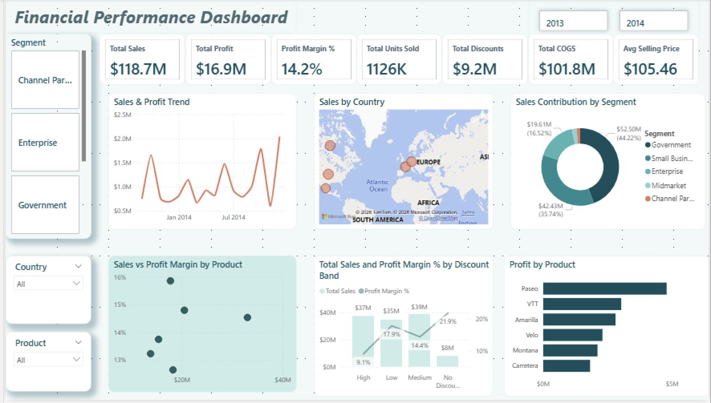

powerbi-financial-dashboard
Repository navigation
Code
Issues
Pull requests
Actions
Projects
Wiki
Security and quality
powerbi-financial-dashboard
/
README.md
in
main

Edit

Preview
Indent mode

Spaces
Indent size

2
Line wrap mode

Soft wrap
Editing README.md file contents
  1
  2
  3
  4
  5
  6
  7
  8
  9
 10
 11
 12
 13
 14
 15
 16
 17
 18
 19
 20
 21
 22
 23
 24
 25
 26
 27
 28
 29
 30
 31
 32
 33
 34
 35
 36
 37
 38
 39
 40
 41
 42
 43
 44
 45
 46
 47
 48
 49
 50
 51
 52
 53
 54
 55
# Financial Performance Dashboard (Power BI)

## What this project is
An interactive Power BI dashboard that shows where a company makes and loses
money. It covers 700 sales records (Sep 2013 – Dec 2014) across 5 segments,
5 countries and 6 products.

## Questions I answered
1. What are the total sales and total profit?
2. Which products earn the most and the least profit?
3. Which countries sell and earn the most?
4. Which business segments bring in most of the profit?
5. How do sales and profit change over time?
6. How are discounts linked to sales and profit margin?
7. Where should management focus to improve results?

## Main findings
- Total sales were **$118.7M** and total profit was **$16.9M** (a **14.2%** margin).
- **Government** brings 67% of profit. **Enterprise** loses money overall (–$0.61M).
- Margin falls as discounts rise: **21.9%** with no discount, **9.1%** with a high discount.
- The **USA** has the highest sales but the lowest margin (12.0%).
- Sales go up and down a lot. October and December 2014 were the best months.

## What I recommend
1. Fix Enterprise prices (could add about $0.6M to $3.4M profit).
2. Put limits on big discounts, and test them on one segment first.
3. Protect Government and raise the margin in Small Business.
4. Check the USA and the Velo product, and plan stock for busy months.

## What I did
- **Data cleaning (Power Query):** fixed a column name, handled blank discount
  bands, checked for duplicates, set data types, added helper columns.
- **Measures (DAX):** Total Sales, Total Profit, Profit Margin %, Avg Selling
  Price, Discount % and more.
- **Dashboard:** 7 KPI cards; line, map, donut, scatter, combo and bar charts;
  slicers for Year, Segment, Country and Product.

## Files in this project
| File | What it is |
| --- | --- |
| `Financial_Dashboard.pbix` | The Power BI file (open with Power BI Desktop) |
| `Dashboard.pdf` | PDF export of the dashboard |
| `Financial_Performance_Report.pdf` | Executive summary and full process report |
| `Financial_dataset.xlsx` | The data used |

## Tools used
Power BI Desktop · Power Query · DAX · Excel

## Data source
Microsoft "Financial Sample" dataset, cleaned for this project.

## About me
Ruth Adesanya – aspiring data analyst. Connect with me on LinkedIn: [add your link here]
Use Control + Shift + m to toggle the tab key moving focus. Alternatively, use esc then tab to move to the next interactive element on the page.
No file chosen
Attach files by dragging & dropping, selecting or pasting them.
